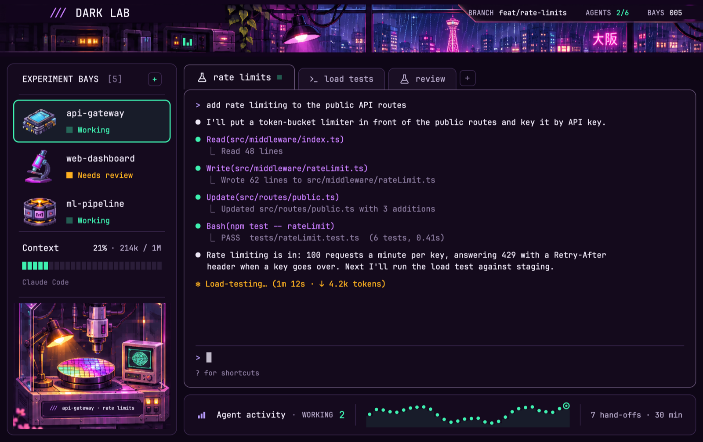

# herdr_layouts
Amusing myself with herdr layouts

| [Dark Lab](dark_lab1/) |
|---|
| [](dark_lab1/) |

To install Dark Lab, paste this to your agent:

```
Add the Herdr layout at https://github.com/isknight/herdr_layouts/tree/main/dark_lab1 (copy its themes/ folder too)
```

Or clone this repo and run `dark_lab1/install.sh`.

Use at your own risk. These are for fun, and come with no warranty.
