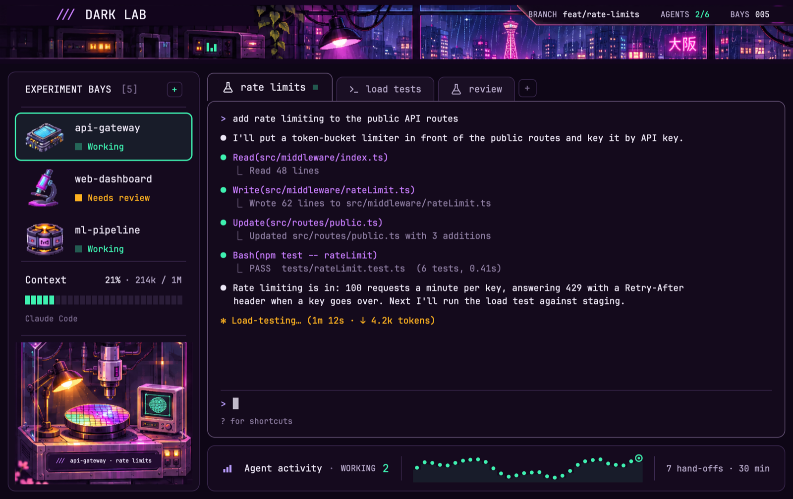

# Dark Lab



A pixel-art lab at night. Rain on the windows, your spaces as experiment bays, a context meter, and a strip of recent agent activity.

## Install

Paste this to your agent:

```
Add the Herdr layout at https://github.com/isknight/herdr_layouts/tree/main/dark_lab1 (copy its themes/ folder too)
```

Or run `./install.sh` from this folder.

## Notes

- The context meter works with Claude Code, Codex, pi and Devin. It reads each agent's local session log and never touches the network.
- The rain, bench lights and lab lights only move while an agent is working, so an idle window stays still and uses little CPU. Click the banner flask to switch between `auto`, `off` (always still) and `on` (always moving), or run `herdr-app do dark_lab1.motion-auto` (or `motion-off`, `motion-on`).
- Updates are off by default. Turn them on with `herdr-app do dark_lab1.updates-notify` (shows an UPDATE readout when this repo has a newer version) or `updates-auto` (installs it). `updates-off` turns them off.
- Herdr doesn't know Devin yet, so `install.sh` adds a small `programs.json` entry for it (only if you don't have that file).
- Made on macOS.
- Use at your own risk. No warranty.
