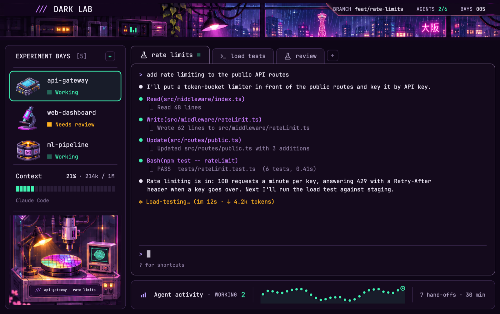

# Dark Lab

A pixel-art lab at night. A banner of a lab bench looking out at a rainy neon city, a sidebar of "experiment bays" (your spaces), a context meter, folder tabs, and a 30-minute activity curve.

## What you see

JetBrains Mono throughout, 14px terminal. Window `#0e0616`, no title bar, macOS traffic lights at `[16, 14]`.

**Banner** — 100px, `#12051c`, drags the window.
- Pixel art (1586×108 source, 3172×216 PNG), contain-fit and centered.
- Left: `///` (bold italic 18px `#c77dff`) + `DARK LAB` (bold 20px `#f4f0ff`). Starts 22 source px in, or 86px on macOS so it clears the traffic lights.
- Right, from source x 1100: `BRANCH name` · `AGENTS 2/6` · `BAYS 005` · flask icon. 12.5px, labels `#b3a6c6`, values `#ece6f5`, 1×14 rules `#3d2a52`. Working count and flask go mint `#3ef0b0` while anything works.
- Rain in the windows only (source x 606 →): `│` in 7px cells, 40% opacity, `#b9b0ff`, every 4th column `#ff8af0`, one column per ~22px. Mullions, wall and lamp stay in front.
- Bench gear: 3 mint meter bars, 9 blinking LEDs, 2 orange glows, a white light sliding in a pink slot.

**Body** — row, 12px padding and gap.

**Sidebar** — 300px, `#150a1e`, 1px `#3d2a52`, radius 12. Split 1.7 : 1.
- *Bays.* Header `EXPERIMENT BAYS [5]` + 24px `+`. Rows 76px, radius 10: icon (tablet → scope → core, cycling), name 15.5px, status square + label 13.5px. Active row: 2px border in its status color, 8% tint.
- *Context.* `Context` · `21% · 214k / 1M`. 26-cell bar, mint lit / `#2a1d38` unlit, amber `#ffb020` at 80%+. Agent name below, or `no agent in focus`.
- *Lab case.* 10px padding, glass-case art (392×480 source), cover-fit, anchored 35% down. Nameplate reads `/// space · tab`. Two amber console lights, a mint monitor glow.

**Work column**
- *Tabs* (46px). Folder tabs, rounded top 10, no bottom border. Active: 44px, bold 15.5px, `#140a1c` (joins the pane), border `#6e5a80`. Inactive: 38px, 14.5px `#b3a6c6` on `#1a0f24`. Icon (flask = agent, `>_` = shell, layers = other), name, 8px status square unless idle. `+` at the end.
- *Panes.* Gap 8, radius 12, `#140a1c`, border `#3d2a52`, focus `#6e5a80`, lone pane framed. Terminal padding `[16, 20]`.
- *Activity* (72px, same panel style). Bars icon, `Agent activity · WORKING 2`, 30 mint dots tracing working agents over 30 min (newest is a pulsing ring), `7 hand-offs · 30 min`.

Status colors: working `#3ef0b0` "Working", blocked `#ffb020` "Needs review", done `#ff5fd2` "Done", idle `#b89cff` "Idle".

## How it behaves

- Bays: click selects, double-click renames, right-click opens the space menu, `+` makes a space. The list keeps the active bay in view.
- Tabs: click selects, double-click renames, middle-click closes, right-click opens the tab menu, `+` opens the new-tab menu.
- Working squares pulse. Banner flask pulses while anything works.
- Rain only falls down, each column at its own speed (18–24ms a step).
- Gear moves slowly on purpose: bars drift ~4 source px (5.2s / 4.3s / 6.1s), LEDs blink every 1.1–3.1s, glows breathe, the white light slides over 2.6s.
- Lab monitor pulses faster while the active space is working.
- Context meter refreshes every 5s. It follows the focused pane if it's an agent, else an agent in that tab, else any working agent.
- Activity: a 30s bucket every 30s, 60 kept, saved across restarts. A hand-off is an agent turning done or blocked.

## Built from

**Layout** `layouts/dark_lab1.json`: root column, `theme: "dark_lab1"`, `titlebar: "none"`, `traffic_lights: [16, 14]`, `divider` width 0, nothing resizable, `preview: "layouts/dark_lab1.png"`.
- `banner` block 100px, `window_drag`, props `{ part: "banner" }`
- `body` row → `sidebar` column 300px (`bays` weight 1.7 min 320; `lab-frame` weight 1, padding 10 → `lab`) and `work` column, gap 12 (`bench` = `tabs` 46px + `main` `{ tab: "active", pane: {...} }`; `history` 72px)

**Theme** `themes/dark_lab1.json`.

**Mod** `mods/dark_lab1/main.js`, `mod.json` `{ "place": "none" }`. One view, switched on `props().part`: `banner`, `bays`, `lab`, `tabs`, `history`. Optional prop `context_window` forces the meter's window size. Uses `spaces, panes, agents, focused, run, openOverlay, window, props, exec, checking` and the shipped `menu` / `new-menu` overlays.

- **Banner**: measures itself (`on_size_change`), contain-fits by hand (`s = min(w/1586, h/108)`), then stacks on that rect: `lab-banner.png` → clipped rain → `lab-banner-front2.png` (glass transparent, lamp opaque) → `gear()` → text. Rain = columns of one-char cells, each running `.frames()`.
- **Bays**: `ScrollHandle` + `scroll_to_item` for the active row.
- **Context meter**: `exec("sh", [script, kind, cwd])` prints the last usage record from the agent's own log:
  - Claude Code: `~/.claude/projects/<cwd, non-alphanumerics → ->/*.jsonl`
  - Codex: `rollout_path` from `~/.codex/state_*.sqlite` (fallback: scan `~/.codex/sessions`), last `token_count`, window from `model_context_window`
  - pi: `~/.pi/agent/sessions/--<cwd>--/*.jsonl`, window from pi's `models-store.json` / `models.json`
  - Devin: `sessions.db` + `transcripts/<id>.json` in `~/Library/Application Support/devin/cli` or `~/.local/share/devin/cli`
  - Window: prop, else reported, else Claude rule (`[1m]`, Claude 5+, or >200k used → 1M; else 200k), else tokens only.
- **Lab**: cover-fit by hand (`s = max(w/392, h/480)`), label and lights placed in source coordinates.
- **History**: `localStorage` `"history"` = `{ at, b: [{ w, e }] }`, smoothed `v = 0.6v + 0.4w`.
- **Updates** (`updater.js`, `version.json`): off by default. Commands `dark_lab1.updates-off | updates-notify | updates-auto | update`. When on, every 6h it curls the repo's `version.json` (source in the local one) and shows `UPDATE vX` (amber, before BRANCH; click installs). Install = download the repo tarball, run the folder's `install.sh`.

**Art** `mods/dark_lab1/art/`: `lab-banner.png`, `lab-banner-front2.png`, `lab.png`, `icon-tablet/scope/core.png`. SVGs: `flask`, `prompt`, `layers`, `bars`.

## Watch out

- **Copy `themes/dark_lab1.json` too.** Herdr's steps only mention `layouts/` and `mods/`.
- **Tell the person:** the mod runs `sh` (plus `sqlite3`, `ls`, `grep`, `tail`, `sed`, `head`, `find`, `xargs`, `tr`, `cat`) and reads agents' session logs outside its folder, only for token counts. No network unless updates are turned on; then it uses `curl` and `tar`, and auto mode runs the downloaded `install.sh`.
- `image()` keeps aspect ratio and backgrounds are only cover/contain, so do the fit math yourself and place every layer from the same `ox, oy, s`.
- Rain goes *between* the two art layers. On top, it falls over the wall and lamp.
- `.loop()` ping-pongs (rain would go back up). Use `.frames()`. It skips newlines, so one cell per row.
- Big, fast gear movement is distracting next to the terminals. Keep it small.
- Herdr caches images by path. New art needs a new filename.
- Bump `version.json` with every change you push, or updates won't see it. A fork should point its `source` at its own repo.
- Banner text sits on cleared areas of this art (brand plate, readout panel).
- Herdr desktop doesn't recognize Devin; it needs a `programs.json` `devin` entry. Devin is untested on a real install.

## Done when

- `herdr-app check` passes; `layout.switch` shows it; `herdr-app status` has no errors.
- Banner art is whole and centered at any width; brand clears the traffic lights; readouts match.
- Rain falls only down, only in the windows, behind the lamp.
- Gear drifts and blinks without jumping.
- Bays show every space with the right status; `+` makes one.
- With Claude Code focused, the meter shows e.g. `21% · 214k / 1M`.
- Tabs select, rename, close; `+` opens the menu.
- Activity shows 30 dots and survives a restart.
- `herdr-app do dark_lab1.updates-notify` shows a toast; with a newer `version.json` in the repo, the UPDATE readout appears.